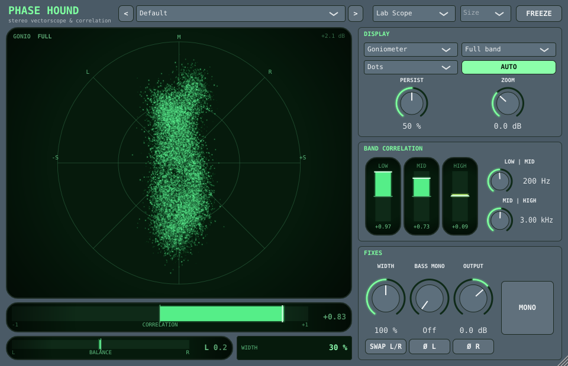
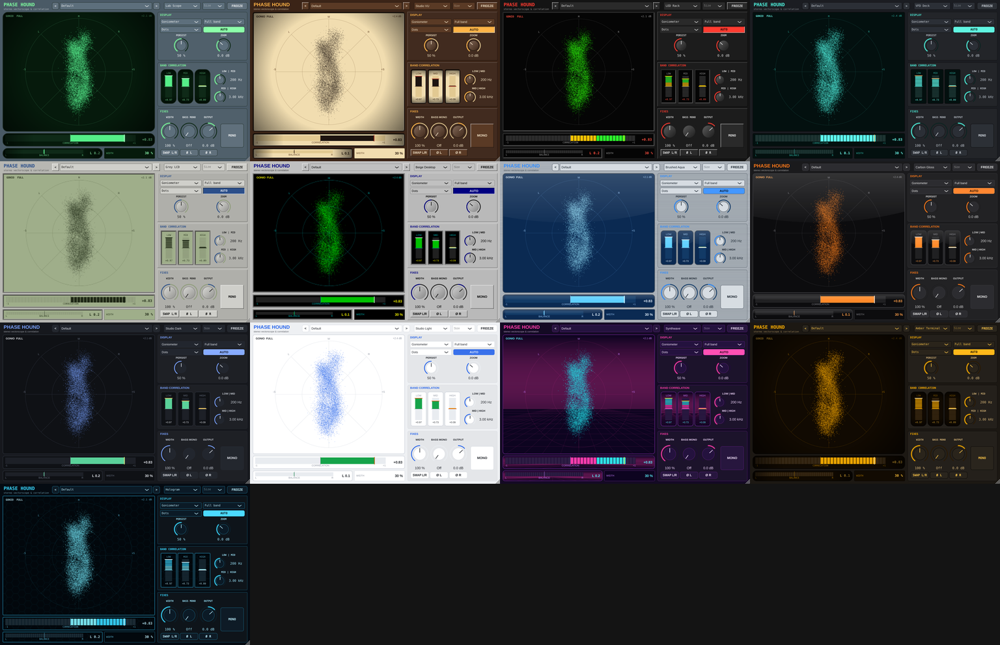

# Phase Hound

A stereo vectorscope and correlation meter (VST3, AU on macOS, plus Standalone). A glowing
phosphor phase cloud, a correlation meter, per-band correlation so you can see *which*
frequencies are out of phase, and a handful of fixes: width, bass mono, mono check, L/R swap
and polarity flips. Sibling of Scope: same 13 era themes and screen rendering. See
[docs/DESIGN.md](docs/DESIGN.md).



## Features

- **Display:** Goniometer (rotated 45°, mono is vertical), Lissajous (classic X-Y) or Polar
  (folded half-disc: in-phase content sits inside the L/R wedge). Phosphor persistence, zoom
  or auto-gain, dots or lines, Freeze. **Band** shows just the Low, Mid or High band in the cloud.
- **Meters:** correlation (-1 to +1, with a 3 s low-water mark), balance, width, and
  per-band correlation for Low / Mid / High with adjustable crossovers.
- **Fixes:** Width 0-200 %, Bass Mono (Off or 60-300 Hz), Mono check (click to latch,
  hold to listen while pressed), Swap L/R, Polarity L and R, Output.
- **Bit-transparent:** with the fixes at their defaults the audio is copied unchanged
  (checked in the tests). Zero latency.
- **Presets:** Default, Mastering, Phosphor Classic, Bass Check, Mono Compatibility,
  Wide Mix, Lissajous X-Y. Theme and window size are saved with the DAW session.



## Installers (Mac and Windows)

Every push builds both installers in GitHub Actions (`.github/workflows/build.yml`) after the
engine tests pass. Download them from the run's **Artifacts**, or push a tag like `v0.1.0`
to publish them on a Release page.

| File | Who it's for | What it installs |
|---|---|---|
| `PhaseHound-<ver>-macOS.pkg` | macOS 11+, Intel and Apple Silicon (universal) | VST3, AU, Standalone app |
| `PhaseHound-<ver>-Windows-Setup.exe` | Windows 10/11, 64-bit | VST3 into `C:\Program Files\Common Files\VST3`, Standalone app |

The builds aren't code-signed yet: on Mac right-click the .pkg and choose **Open**; on
Windows click **More info > Run anyway**.

The Standalone app starts with its input muted (JUCE's feedback guard). Turn it on in
**Options > Audio/MIDI Settings** and pick your interface input.

## Build

```
cmake -B build -DCMAKE_BUILD_TYPE=Release            # fetches JUCE 8.0.4
# or: cmake -B build -DJUCE_DIR=/path/to/JUCE
cmake --build build --config Release
ctest --test-dir build                                # engine tests
```

macOS builds target macOS 11+ universal (Intel + Apple Silicon). No AVX2 or other
`-march` flags are used; the DSP is scalar C++. Windows builds use the static runtime.
Linux needs `libasound2-dev libx11-dev libxrandr-dev libxinerama-dev libxcursor-dev
libfreetype-dev libfontconfig1-dev libgl1-mesa-dev`.

`-DPHASEHOUND_BUILD_SNAPSHOTS=ON` adds `phasehound_snapshots <dir>`, which renders the editor in
every theme and a few presets to PNGs (`xvfb-run` on a headless Linux box).

## Layout

```
Source/engine/Dsp.h        biquads, Linkwitz-Riley split, ramps
Source/engine/Engine.*     fixes, correlation / band / balance / width analysis, scope feed
Source/engine/Fifo.h       lock-free audio -> UI stereo sample FIFO
Source/engine/Presets.h    display presets
Source/plugin/*            JUCE processor, editor, phosphor scope and meters, themes
tests/EngineTests.cpp      engine tests (no JUCE)
tools/Snapshots.cpp        screenshot renderer
```
